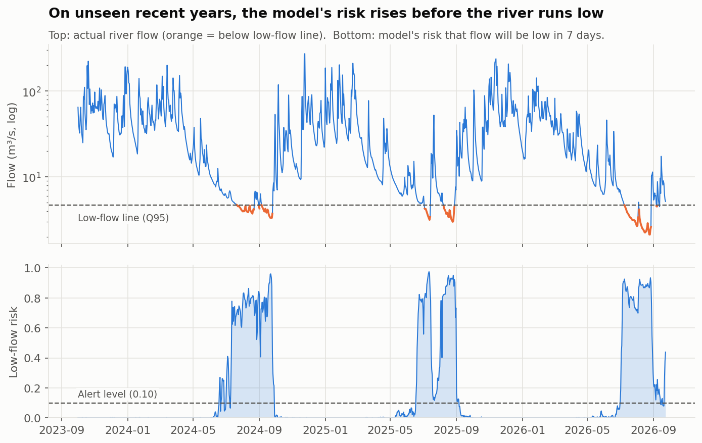

# River Low-Flow Early Warning

**Will the river run low next week?** A 7-day early-warning model for Irish river low flows,
built from public OPW/EPA river-flow data and Met Éireann rainfall.

**[Read the full report →](https://bymankirat.github.io/irish-water-low-flow-warning/)**



## Why this matters

When rivers fall to their lowest levels, water suppliers have less to abstract and less margin for
error. A warning a week ahead gives time to check storage, plan abstraction and prepare customer
messaging before supply comes under pressure. This project asks whether that warning can be
produced from data that is already public and free.

## What I did

1. **Data:** daily river flow for the River Blackwater at Mallow Railway Bridge, Co. Cork (OPW station 18055) and
   daily rainfall at Cork Airport (Met Éireann), 2005 onwards.
2. **Defined "low flow"** as below **Q95**, the flow the river stays above 95% of the time, and
   checked my value against the figure the EPA publishes for the station.
3. **Explored** when low flows happen (late summer) and how long the river "remembers" rain.
4. **Built features** using only information available on the forecast day: recent flow, rain
   totals over 1 to 90 days, days since meaningful rain, and time of year.
5. **Trained a random forest** to predict whether flow will be below Q95 in 7 days.
6. **Tested honestly:** trained on older years, tuned the alert level on the next 2 years, and
   tested once on the most recent 3 years, which the model never saw.
7. **Compared with a simple rule** an operator might use ("warn when the river is already low")
   and measured how many low-flow episodes each warned of **before** they began.

## Results (test years 2023-2026, never seen in training)

| | Simple rule | Model | Warning system |
|---|---:|---:|---:|
| Low-flow episodes warned before they began | 0 of 4 | 4 of 4 | 4 of 4 |
| Episodes flagged a full 7 days ahead | 0 of 4 | 4 of 4 | 4 of 4 |
| Low-flow days flagged a week ahead | 72% | 99% | 99% |
| Alerts that were right | 72% | 55% | 55% |
| False-alarm days per year | 13 | 39 | 39 |

Low-flow line (Q95): 4.720 m3/s. Model ROC AUC: 0.96.

## Run it yourself

```bash
pip install -r requirements.txt
python get_data.py          # downloads rainfall, explains the 2-minute flow download
python run_pipeline.py      # runs everything and builds docs/index.html
```

No data yet? `python run_pipeline.py --demo` runs on simulated data (every output is marked DEMO).

To try another river, change `FLOW_STATION` and `RAIN_STATION` in `src/config.py`.

## Project structure

```
get_data.py            step 1: get the raw data
run_pipeline.py        step 2: clean -> features -> model -> charts -> report
src/
  config.py            stations and settings
  data_loading.py      reads OPW/EPA and Met Éireann files in any common layout
  features.py          model inputs (no future information)
  modelling.py         time-based split, model, simple rule, lead-time analysis
  charts.py            figures
  report.py            self-contained web page
reports/               figures, results.json, day-by-day test forecasts
docs/index.html        the published report (GitHub Pages)
```

## Limits and next steps

- One river and one rain gauge. Next: repeat across several drinking-water supply catchments.
- Uses past rain only. Adding Met Éireann's rainfall forecast should lengthen the warning.
- No abstraction or groundwater-level data, which would sharpen the forecast.
- Few low-flow episodes in any 3-year test window, so results are indicative.

## Data and licences

- River flow: OPW / EPA hydrometric network ([waterlevel.ie](https://waterlevel.ie/hydro-data/),
  [EPA HydroNet](https://epawebapp.epa.ie/hydronet/)), CC BY 4.0.
- Rainfall: [Met Éireann](https://www.met.ie/climate/available-data/historical-data), CC BY 4.0.

Mankirat Singh · [LinkedIn](https://linkedin.com/in/mankirat-singh-694440177) · [GitHub](https://github.com/bymankirat)
